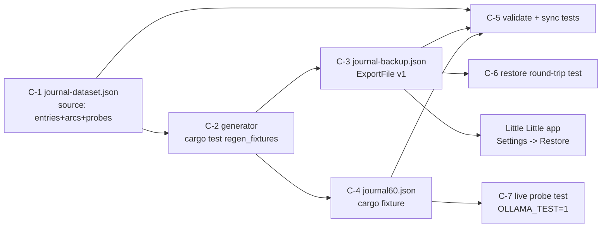
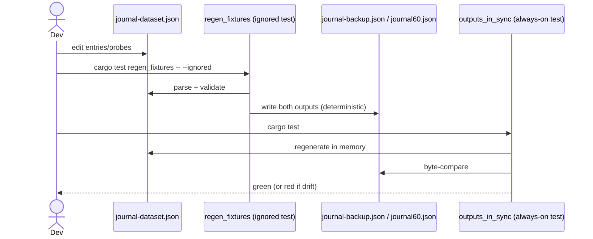
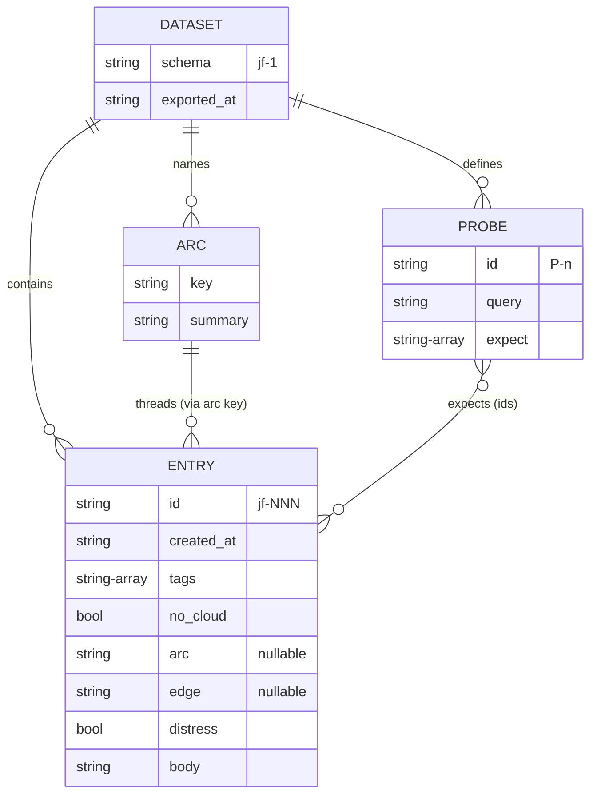

# journal-fixtures — design diagrams

## Product flow

```
1  --> developer wipes the dev journal (fresh passphrase)
2  --> onboarding: pick memory + reflection models
3  --> Settings -> Restore backup... -> journal-backup.json
4  --> "60 entries restored — re-indexing in the background"
5  --> chips: indexing n of 60, then moods fill the calendar
6  --> calendar shows 6 believable months; search "when did I decide to leave my job" cites the right dates
7  --> a new entry about work gets a reflection calling back to the arc
```

Check:
- Does step 3 need anything beyond the existing Restore button (it must not)?
- Is "restore only into an empty journal" acceptable friction for repeated test runs?
- Will 60 entries index + classify fast enough to be usable right after restore (~0.43s/entry mood → ~30s)?

## Components



Check:
- Is every file consumed by at least one test (nothing write-only)?
- Should C-7 read C-4 or C-1? (C-4: it tests what tests use.)

## Regen and sync sequence



Check:
- Can any path write the outputs other than the regen test?
- Is byte-identity achievable (one serializer, fixed exported_at, stable sort)?

## Source data model



Check:
- Are the test-only fields (arc, edge, distress) clearly separated from what reaches the outputs?
- Do probes referencing entry ids survive regeneration (ids are stable by rule)?
