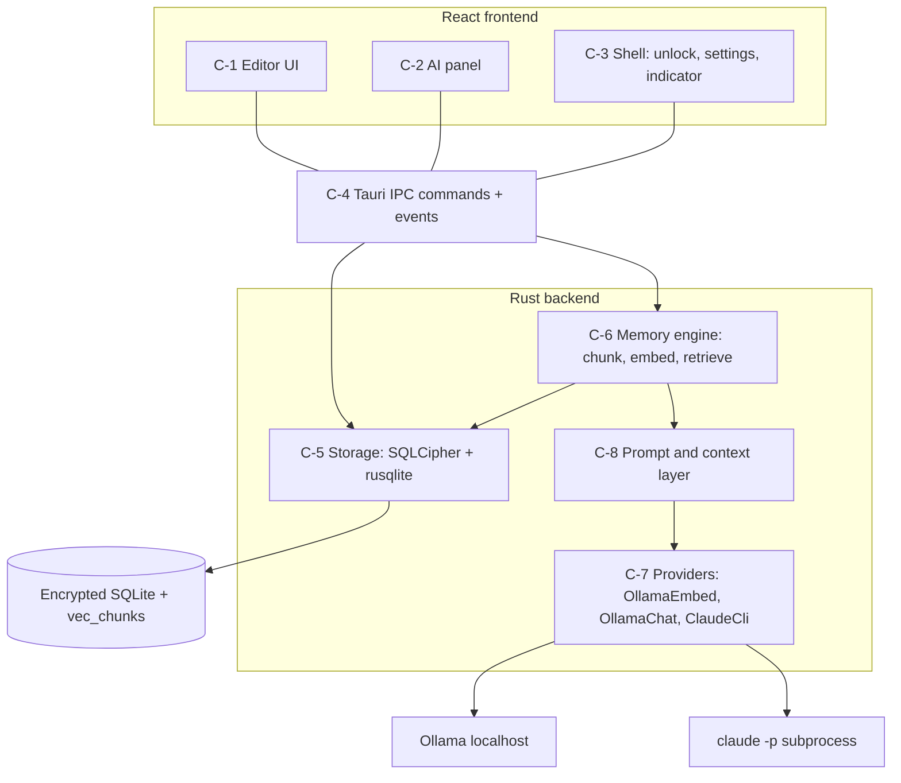
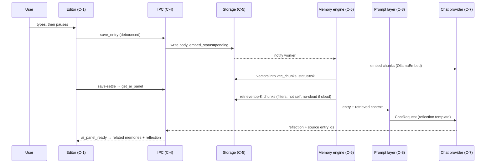
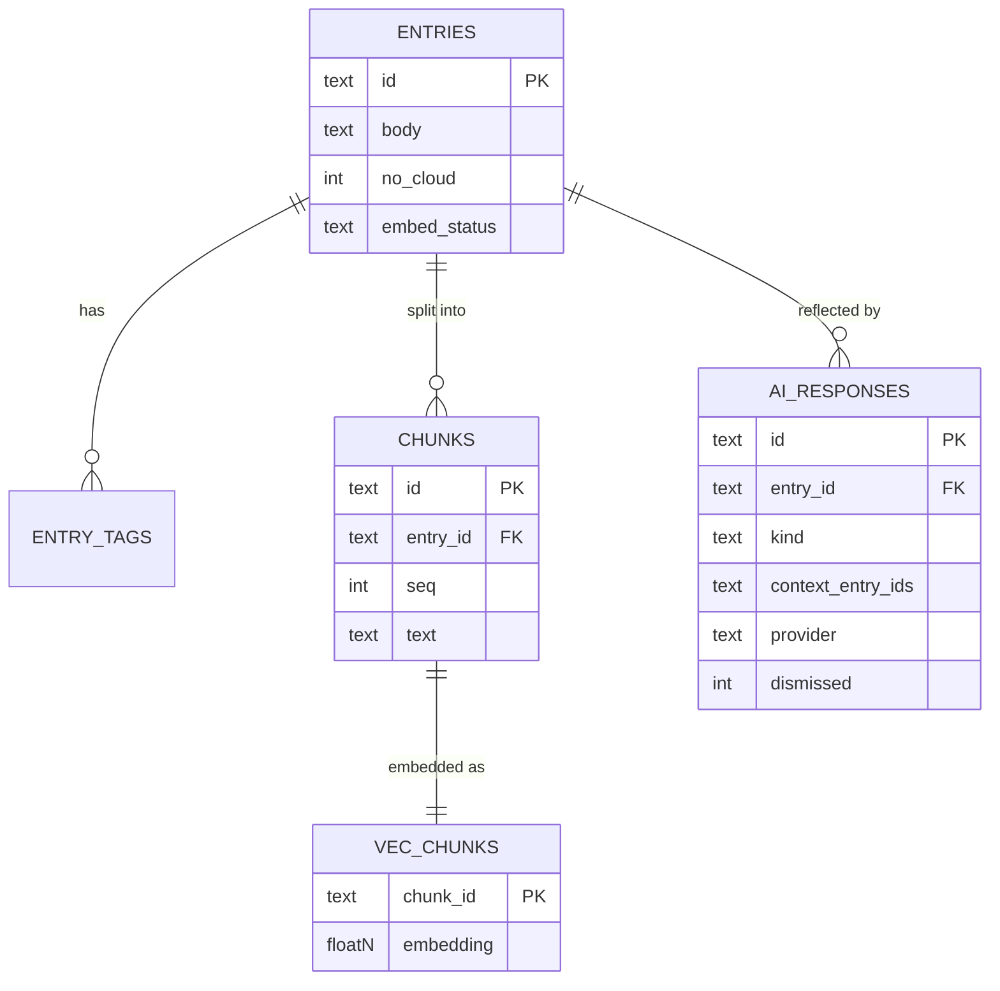
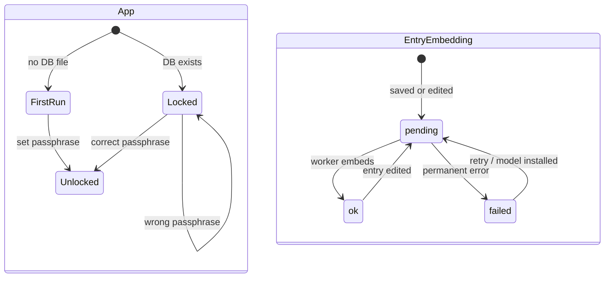
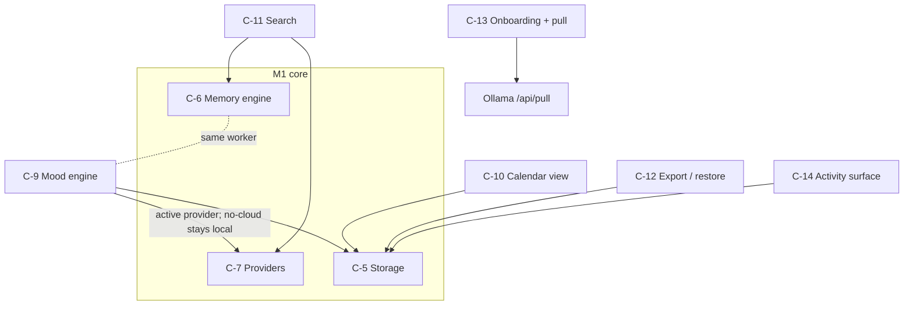
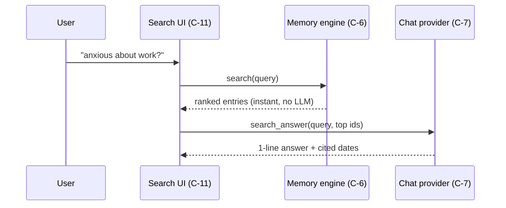
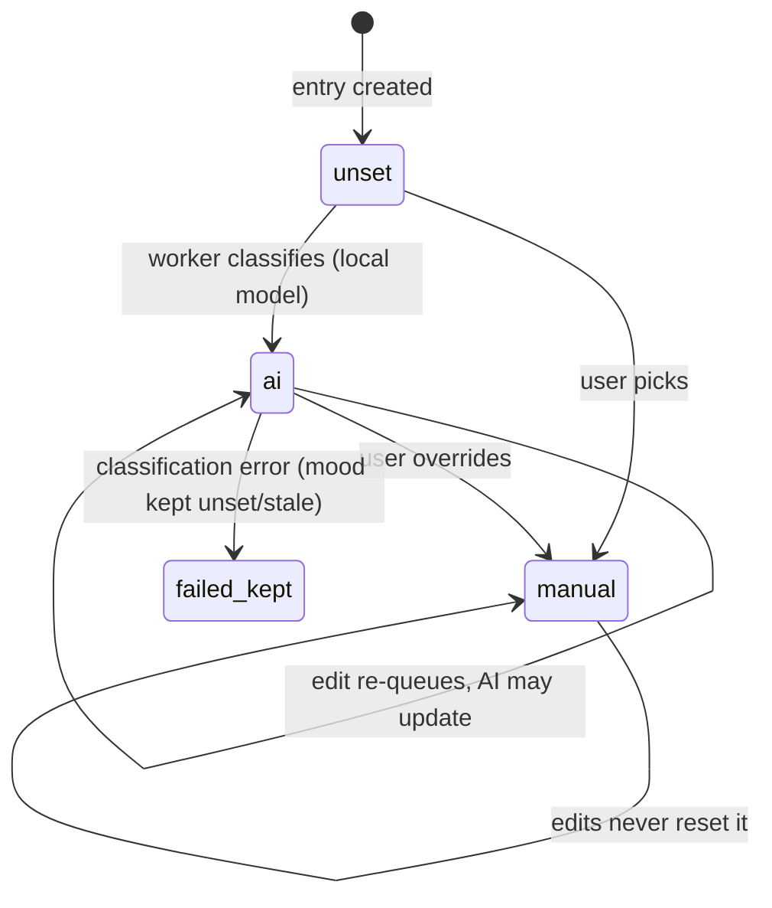

# little-little — design diagrams

## Product flow

```
1  --> First launch: choose a passphrase
1b --> Pick your models in settings (nothing is pre-selected); AI features wait until you do
2  --> Write today's entry; it saves itself as you type
3  --> A moment after you stop, the side panel shows past entries that relate to what you wrote
4  --> Below them, a short caring reflection, citing the entries it drew on
5  --> Regenerate it, dismiss it, or just keep writing
6  --> Settings: switch between On-device (Ollama) and Cloud (Claude); first switch to Cloud asks you to confirm; the badge in the corner always shows which is active
7  --> Mark any entry "never send to cloud"; it stays out of anything sent to Claude
```

Check:
- Does the reflection appearing *after* save-settle (not live while typing) match the calm, non-intrusive feel?
- Is a corner badge enough of a privacy indicator, or should switching to Cloud require an extra confirmation?
- First entry ever: panel says "nothing to relate yet" — good enough for the empty state?

## Components



Check:
- All AI/DB state lives behind C-4; the frontend holds no journal data beyond what's displayed — acceptable?
- C-8 sits between memory engine and providers so personas can swap without touching retrieval — clear?

## Save → embed → reflect (primary sequence)



Check:
- Reflection waits for the new entry's own embedding only to build the query vector — is mean-of-chunks as the query acceptable for M1?
- If embedding is still running at save-settle, panel shows "thinking…" and fills when ready — OK?

## Data model



Check:
- `context_entry_ids` as JSON on the response row is the whole "honest AI" audit trail — sufficient?
- Cascade deletes cover AC-8's delete path — any orphan risk in vec_chunks (no FK support in vec0 virtual tables)?

## Lifecycles



Check:
- `ok → pending` on every edit means frequent small edits re-embed the whole entry — fine at journal scale?
- `failed` is only for permanent errors (missing model); transient Ollama outages stay `pending` — clear enough for debugging?

## M2 additions (components)



One worker loop handles embeddings then moods; search reuses retrieval; onboarding is a guided path over existing settings commands plus the pull manager.

Check:
- Mood engine uses the active provider, but no-cloud entries never reach ClaudeCli (local fallback/unset) — matches ADR-0004 as accepted?
- Calendar reads storage directly (no AI) — fast and offline, right?
- Is a per-call progress channel (pull) consistent enough with the otherwise pull-based IPC?

## Search sequence (M2)



Check:
- Results render before any model call — does the UI make the answer clearly optional/late?
- When the provider is cloud, the no-cloud entries were already filtered at KNN — acceptable that on-device search finds MORE than cloud-mode search?

## Mood lifecycle (M2)



Check:
- `manual` as an absorbing state — exactly the AC-19 guarantee?
- AI re-classifying on edit (while source='ai') — desirable, or should the first AI mood stick?
