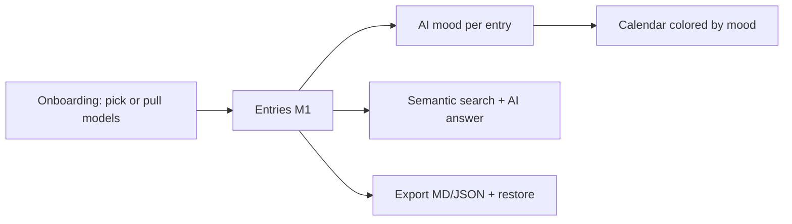

# Little Little — Spec (M2: see how far you've come)

M1 (walking skeleton: encrypted journal, editor, embeddings, related memories + reflection, Ollama + claude -p) shipped and verified 2026-11-05 — results in `verify.md`, ACs 1–17 in `status.yaml`. This spec now describes **M2**.

## 0. Review guide

**Summary:** M2 turns the skeleton into a daily app: a mood-colored calendar, plain-language semantic search with an AI answer line, Markdown/JSON export with restore, a first-run onboarding that gets models working without visiting raw settings, and a settings pane that clearly shows model state instead of being vague after selection.



**Review order:** this section → §4 Scope → §6 Acceptance criteria → rest.

**Decisions**

| ID | Decision | Status |
|----|----------|--------|
| D-1…D-6 | M1 decisions (location, skeleton, providers, encryption, cloud confirm, no default models) | Decided — see git history of this file |
| D-7 | M2 scope | Decided: calendar+mood, semantic search, export/backup, onboarding, settings-UX clarity; app lock & quick entry stay backlog (2026-11-05) |
| D-8 | Mood model | Decided: 5 fixed levels (rough/low/okay/good/great) for color + optional free emotion label; manual always wins (2026-11-05) |
| D-9 | Search shape | Decided: ranked entries + one-line AI answer citing its sources (2026-11-05) |

**Open risks**

- Ollama `/api/pull` streaming-progress response shape is [memory], not yet verified — design stage must spike it before building the download UI.
- Mood classification quality from a 4B local model is unproven; prompt + 5-level scale chosen to be easy, but measure on the fixture journal first.
- AI answer per search adds latency (1–3s local); ranked results must render instantly regardless.

**Prerequisites the user owns**

- Ollama kept installed; disk space for any model downloads triggered from onboarding.
- (Unchanged from M1) Claude Code signed in if the cloud provider is used.

## 1. Problem

M1 proves the loop but the app doesn't yet *show progress over time* (no calendar, no moods), can't *find* old entries by meaning, traps data inside the encrypted file (no export), and getting models working is a vague settings detour — after picking a model nothing clearly says what happened or whether the app is ready.

## 2. Goals

| Goal | Measured by |
|------|-------------|
| See the journey at a glance | Calendar colored by mood; manual overrides stick (AC-18–20) |
| Find anything by meaning | Search answers "when did I last feel anxious about work?" (AC-21–23) |
| Own your data | Export to Markdown/JSON; JSON restore round-trips exactly (AC-24–25) |
| Working AI without expertise | Fresh install reaches a ready state through guided onboarding incl. model download (AC-26–28) |
| No vague states | Every model/AI operation shows an explicit status (AC-29) |

## 3. Data / reality

- M1 foundation [verified in verify.md]: retrieval, providers, worker, encrypted storage all tested and live-model-proven.
- Ollama `/api/pull` exists and `ollama pull` streams layer progress [memory — spike in design]. `/api/tags`, `/api/embed`, `/api/chat` shapes [verified in M1].
- Fixture journal (12 entries, dated, tagged, one no-cloud, distress arc) available for mood + search tests [verified].
- qwen3:4b-instruct produced good structured outputs in M1 (reflection quality high in live test) [verified]; mood classification output shape must be constrained (JSON) [assumption].

## 4. Scope — M2

**In**

- **Mood engine:** AI assigns `level` (1–5) + optional free `label` per entry in the background worker (same queue as embedding); manual mood picker on each entry; manual wins permanently
- **Calendar view:** month grid, day colored by that day's mood (manual-first, latest entry per day), click day → its entries; month navigation
- **Semantic search:** search box; query embedded locally; ranked entries (date + snippet, click to open); one-line AI answer above results citing the entries used; no-cloud filter applies when provider is cloud
- **Export / backup:** export all entries to Markdown files (frontmatter: date, tags, mood) and to a single JSON backup; restore JSON into an empty journal
- **Onboarding:** first-run (after passphrase) guided setup — pick installed models or pull one with live progress; Claude Code detected or guidance shown; ends in a visibly "ready" app
- **Settings-UX clarity:** per-model status chips (ready / probing / downloading n% / re-indexing i of n); global unobtrusive AI activity indicator; panel invite disappears the moment models are ready

**Out (→ backlog)**

App lock/biometrics, quick entry (tray/shortcut), writing prompts, mood timeline/trends (M3), summaries, on-this-day, alerts/reminders, tone presets, photos, llama.cpp, signing, sync, mobile.

## 5. Users and key flows

1. **Fresh user:** passphrase → onboarding: "pick or download your models" → progress bar → "you're ready" → first entry.
2. **Daily:** write → mood appears quietly on the entry (editable) → calendar fills with color over weeks.
3. **Remembering:** types "anxious about work" in search → AI line: "Early March, before the Northwind interview — it went well (2026-03-06)" → ranked entries below.
4. **Leaving-proof:** Settings → Export → folder of Markdown + a JSON backup; a new machine restores the JSON.

## 6. Acceptance criteria

```
AC-18 AI mood assigned in background
  Given models selected and a saved entry with clearly positive text
  When  the background worker processes it
  Then  the entry has mood level 4 or 5 and optionally a label, without blocking the editor
  Verify: auto

AC-19 Manual mood always wins
  Given an entry with an AI-assigned mood
  When  the user sets a different level manually and the entry is later edited and re-processed
  Then  the manual level remains; AI never overwrites it
  Verify: auto

AC-20 Calendar colored by mood
  Given entries with moods across several days in a month
  When  the calendar view is opened
  Then  each such day shows its mood color (manual-first), clicking a day lists its entries,
        and adjacent months are reachable
  Verify: auto

AC-21 Semantic search ranks relevant entries
  Given the fixture journal embedded
  When  searching "anxious about work"
  Then  interview/work entries rank above gym/family ones, each result shows date + snippet
        and opens the entry
  Verify: auto

AC-22 Search AI answer cites sources
  Given search results and an available chat provider
  When  the AI answer is generated
  Then  a one-line answer appears above results listing the entry dates it drew on
  Verify: auto

AC-23 Search respects no-cloud under cloud provider
  Given a no-cloud entry matching the query and provider = claude_cli
  When  the search AI answer is generated
  Then  no text from the flagged entry reaches the provider; on-device search still finds it
  Verify: auto

AC-24 Markdown export is readable outside the app
  Given a journal with entries, tags and moods
  When  exporting to Markdown
  Then  a folder contains one .md per entry with date/tags/mood frontmatter and the full body
  Verify: auto

AC-25 JSON backup round-trips
  Given a JSON export of a journal
  When  restored into a fresh empty journal
  Then  entries, tags, moods and no-cloud flags are identical; restored entries re-embed
  Verify: auto

AC-26 Onboarding reaches a ready state
  Given a fresh journal right after passphrase setup
  When  the user completes onboarding by picking installed models
  Then  the app lands in the editor with AI ready (no settings detour, invite gone)
  Verify: auto

AC-27 Model download with live progress
  Given onboarding and a model not installed locally
  When  the user chooses to download it
  Then  pull progress is shown live until completion, then the model is selectable
  Verify: auto (mocked pull stream; live pull = manual)

AC-28 Claude guidance when absent
  Given claude is not on PATH
  When  onboarding/settings presents the cloud option
  Then  it is disabled with install/sign-in guidance instead of failing later
  Verify: auto

AC-29 Model and AI state is never vague
  Given any model operation (probe, download, re-index) or background AI work
  When  it is in progress or finishes
  Then  settings shows a per-model status chip (ready / probing / downloading % / indexing i of n)
        and a global unobtrusive activity indicator reflects busy/idle
  Verify: auto
```

Provisional targets — measure first: mood prompt accuracy on fixture arc (eyeball), search K (start 8), AI answer length (1–2 sentences), calendar initial render with 1k entries.

## 7. Non-functional requirements (M2)

- Ranked search results render without waiting for the AI answer (answer streams in after).
- Export writes only into a user-chosen directory; restore is transactional (all-or-nothing).
- Mood/embed work shares the single background worker; editor latency unchanged.
- Onboarding fully skippable; everything it does remains reachable in settings.

## 8. Assumptions

- Mood levels map 1=rough, 2=low, 3=okay, 4=good, 5=great; calendar palette derived from theme tokens. [assumption]
- Mood classification runs via the chat provider with a JSON-constrained prompt; failures leave mood unset (never block). [assumption]
- Day color uses the latest entry of that day (manual-first). [assumption]
- Search AI answer reuses the M1 persona/no-cloud plumbing. [assumption]
- Restore only into an empty journal in M2 (no merge). [assumption]

## Appendix: Glossary

(M1 terms in git history of this file: RAG, embedding, chunk, sqlite-vec, SQLCipher, Ollama, claude -p, provider, KNN.)

- **Mood level** — 1–5 scale stored per entry; drives calendar color.
- **Mood label** — optional free emotion word the AI may add ("anxious", "proud").
- **Manual-first** — wherever AI and manual values coexist, the manual one is displayed and preserved.
- **Pull** — Ollama's model download operation (`/api/pull`), streamed with progress.
- **Status chip** — small labeled state badge (ready / probing / downloading / indexing).
- **Frontmatter** — YAML header block at the top of an exported Markdown file.
