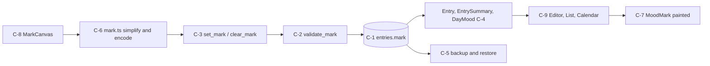
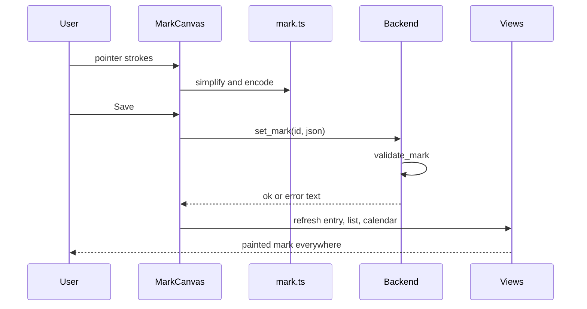
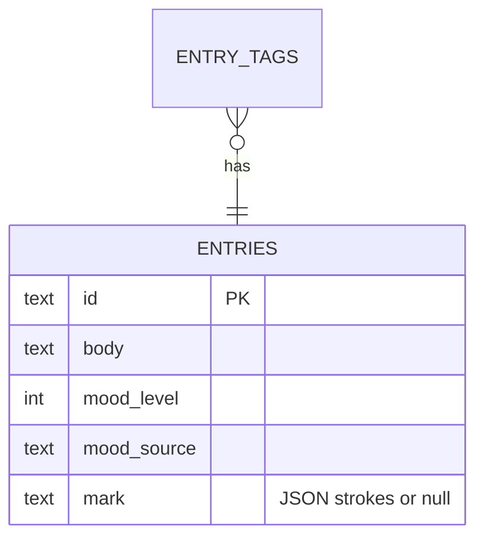
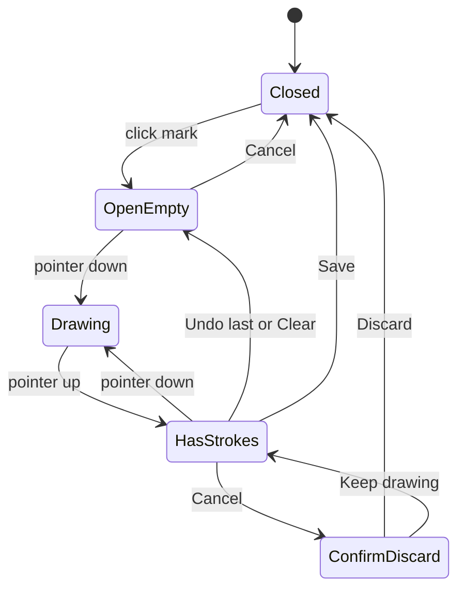

# paint-marks — design diagrams

## Product flow

```
1. User opens an entry --> the header shows its mark (default mood mark or the ring)
2. User clicks the mark --> a small canvas opens
3. User draws with the pointer --> strokes appear as they draw
4. User presses Undo / Clear if unhappy --> nothing is saved yet
5. User presses Save --> the painted mark replaces the default one in the header, the list and the calendar
6. User changes the mood later --> the same shape, the new mood colour
7. User presses "Use default mark" --> the default mood mark returns
8. User backs up and restores --> painted marks come back
```

Check:
- Is there any step where the user can lose a drawing by accident (e.g. closing the canvas)?
- Does step 6 match what you expect (shape kept, colour follows mood)?
- Is the calendar showing the right mark when a day has several entries?

## Components

Small backend slice plus one drawing component and a render prop.



Check:
- Does anything other than C-2 write to `entries.mark`?
- Is validation on every path that writes a mark (command and restore)?
- Does any AI path read `mark`? (it must not, C-10)

## Paint and save

Sequence from stroke to display.



Check:
- What does the user see if `set_mark` returns an error?
- Is the list refreshed without moving the writing area's scroll position?

## Data model

One nullable column.



Check:
- Does the blank-draft cleanup also check `mark IS NULL`?
- Does an old v2 journal open with `mark` null for every entry?

## Canvas lifecycle

States of the drawing surface.



Check:
- Is the discard confirmation shown only when strokes exist (D-8)?
- Can Save be pressed at the stroke or size limit?
