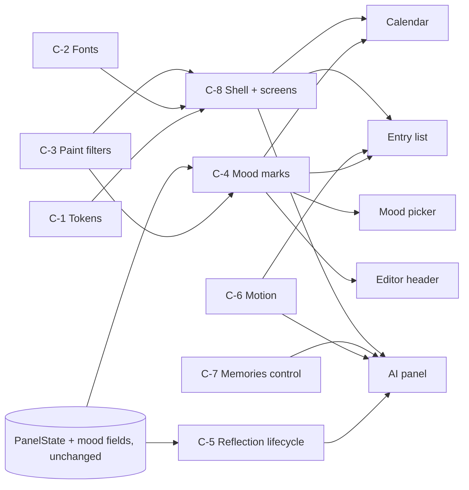
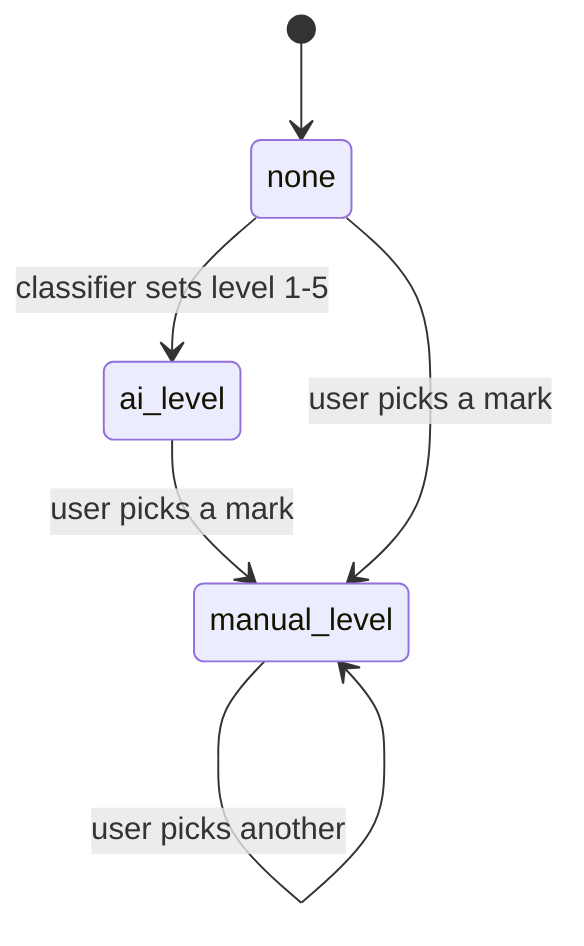
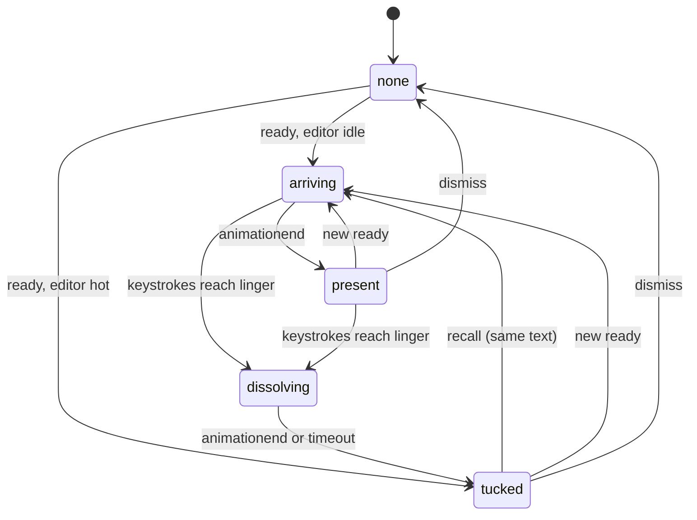
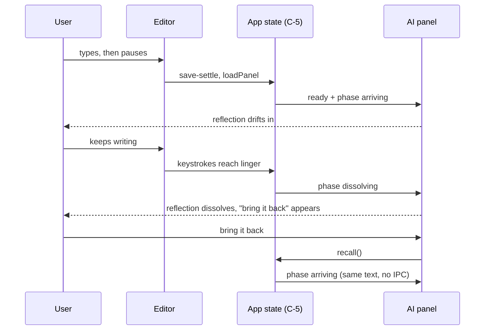

# Painted UI — design diagrams

## Product flow

```
1  Open the app --> the lock screen: an open ring, the wordmark, an underlined passphrase line
2  First time only --> set up your companion: pick or download the memory and voice models
3  Journal opens --> entries on the left, each with its mood mark; today's page in the middle
4  Write --> the big marker date, Spectral text, the mood row and tags at the foot
5  Pause --> a watercolour reflection drifts in on the right; "3 memories" waits underneath
6  Keep writing --> after a dozen or so keystrokes the reflection dissolves; "bring it back" stays
7  Pick a mood mark --> your choice replaces the AI guess everywhere, at once
8  Open the calendar --> every day shows its mood's mark; days with entries but no mood show a ring
9  Search --> an underlined line, the answer as a wash, results as notes with a mood-coloured bar
```

Check:
- Is the lock screen the right first impression, or should it show the five mood marks?
- Does anything in the flow need a screen that is not in the replacement map (spec §5)?
- Is "no mood" understood at a glance as an open ring?

## Component diagram



Check:
- Is C-4 the only place a mood becomes a picture (no screen draws its own)?
- Does anything here need a backend change? (it must not)

## Mood marks (state)



`none` shows the open ring; `ai_level` shows the level's mark plus an "AI guess" hint; `manual_level`
shows the mark with no hint and is never overwritten by the classifier.

Check:
- Is there any way back to `none` once a mood is set? (not today, and not added here)
- Does a free-text `mood_label` with no level show the ring?

## Reflection lifecycle (state)



Check:
- Can the reflection get stuck in `dissolving`? (timeout fallback prevents it)
- Is ~14 keystrokes the right linger?

## Sequence — write, dissolve, recall



Check:
- Does the keystroke path do anything beyond a counter before the editor re-renders?
- Is the recalled reflection clearly dated by its "from ..." line?

No ER diagram: nothing is stored. No deployment diagram: it ships inside the existing app bundle.
