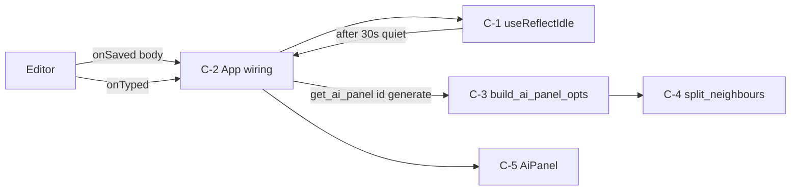
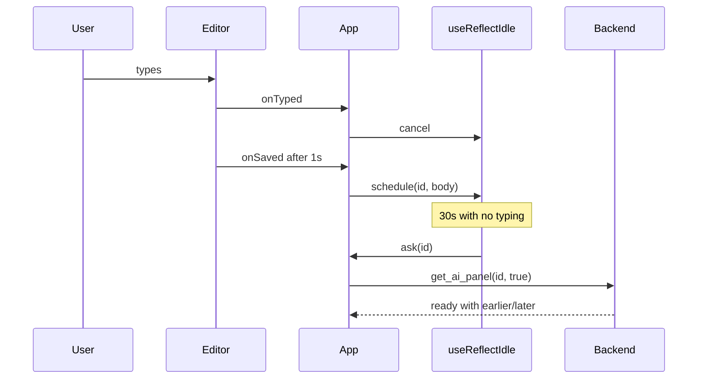
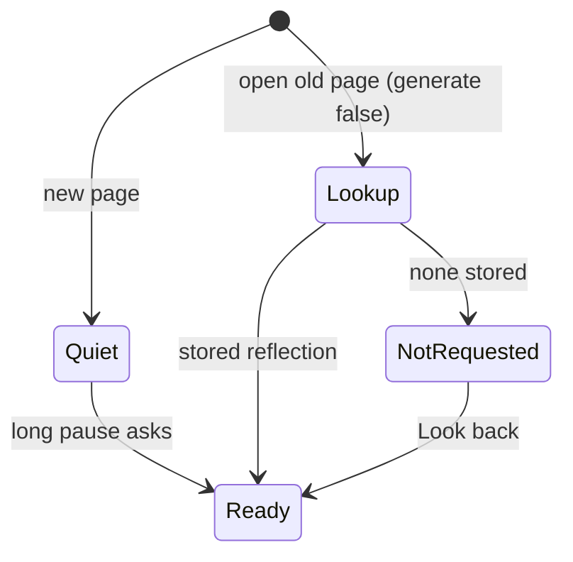

# quiet-memories — design diagrams

## Product flow

```
1. User writes a new page --> nothing appears on the right while they type
2. User pauses (half a minute) with enough written --> memories and a reflection arrive
3. User keeps typing instead --> still nothing; the wait starts over after the next pause
4. User opens an older page --> sees its stored reflection, or a quiet "Look back"
5. User clicks "Look back" --> memories and a reflection are made for that page
6. User opens "N memories" --> Earlier and Later groups
```

Check:
- Is half a minute the right feel, or too long?
- Is "Look back" discoverable enough for pages with no reflection?

## Components



Check:
- Is C-1 the only place that decides "enough to reflect"?
- Does any path call get_ai_panel with generate true other than idle, Look back, or Regenerate?

## New page: write, pause, ask



Check:
- What if the user switches page during the 30 s?
- Does the timer survive leaving the Journal view?

## Panel state per page



Check:
- Can a page show NotRequested forever if the user never clicks?
- Is there any state that calls the model without a user action or the pause?
