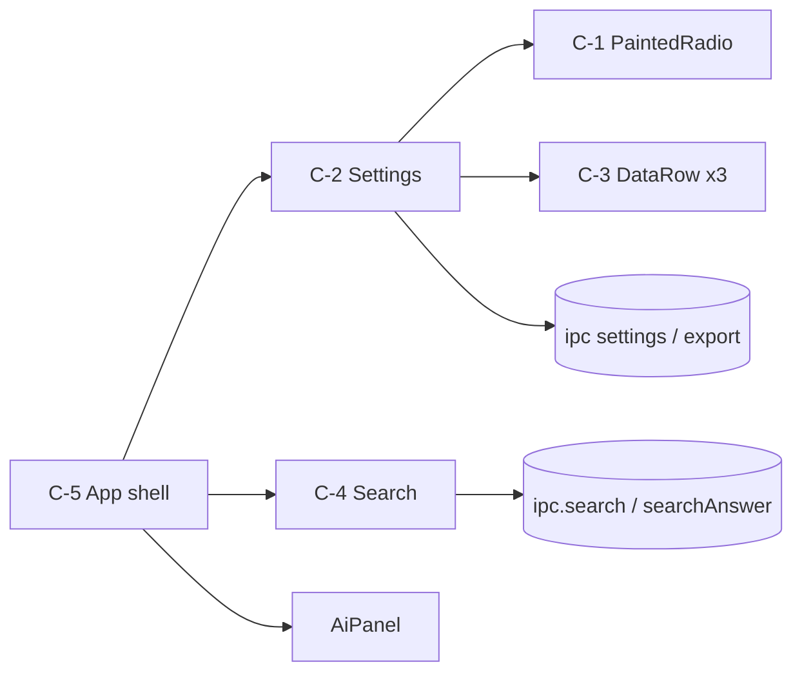
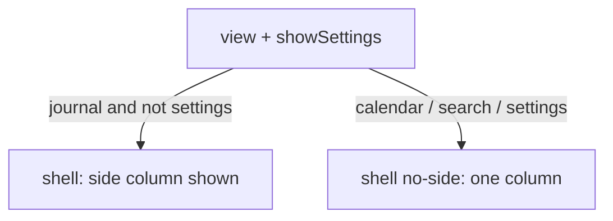
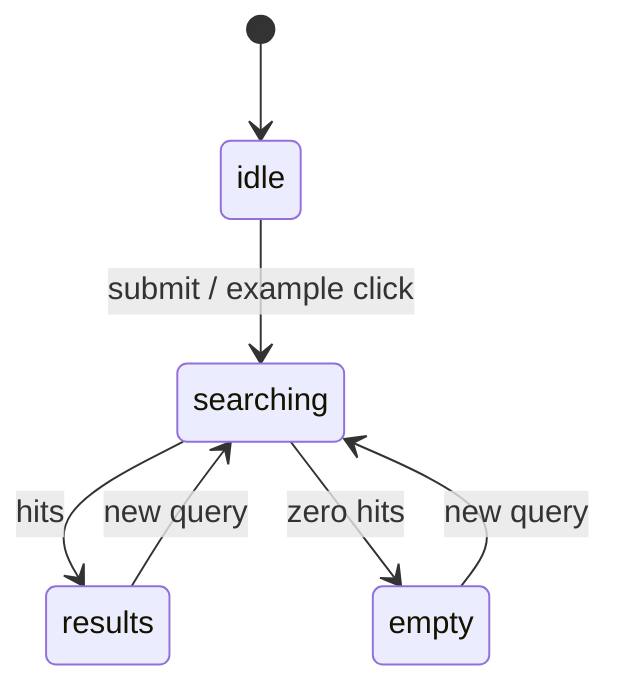

# settings-search-polish — design diagrams

## Product flow

```
1. User opens Settings --> page shows Back ✕, provider choice with a clearly filled radio
2. User clicks the other provider --> the filled dot moves at once
3. User scrolls to Your data --> three rows each say what they do
4. User presses ✕ or Esc --> returns to the view they came from
5. User opens Search --> sees a short explanation and example questions, no memories column
6. User types a question and presses Search/Enter --> "searching…", then answer card and dated results
7. User clicks a result --> Journal opens on that entry, memories column returns
```

Check:
- Is it clear on step 1 which provider is active?
- Does leaving Settings return to Search/Calendar if that was the origin?

## Components



Check:
- Is anything here that needs a backend change? (should be no)
- Is C-5 the only place that decides side-panel visibility?

## Side panel visibility



Check:
- Do gate and onboarding also lose the column? (yes, decided)
- Does the journal layout at 900px stay unchanged?

## Search states



Check:
- Is there a state for search failure? (today: treated as empty)
- Does a stale answer from an older query ever show?
