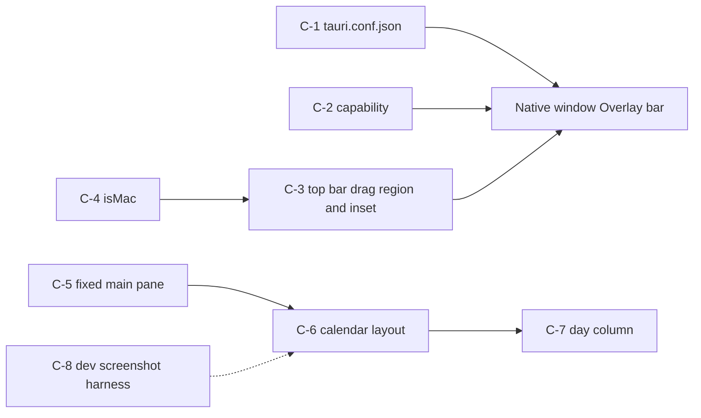
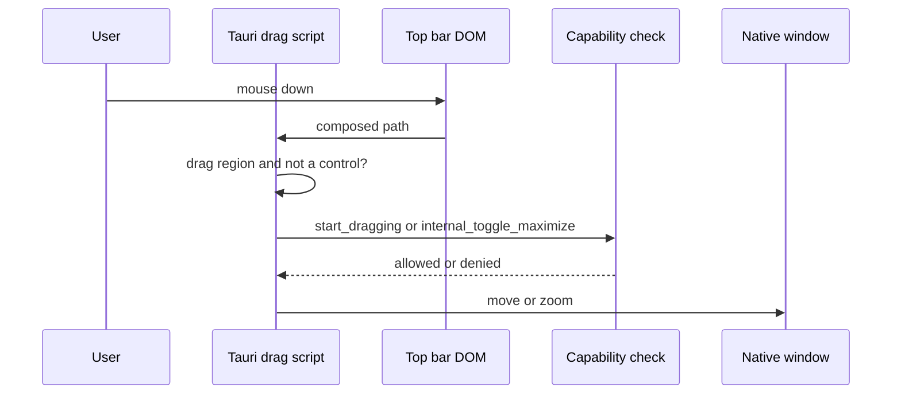
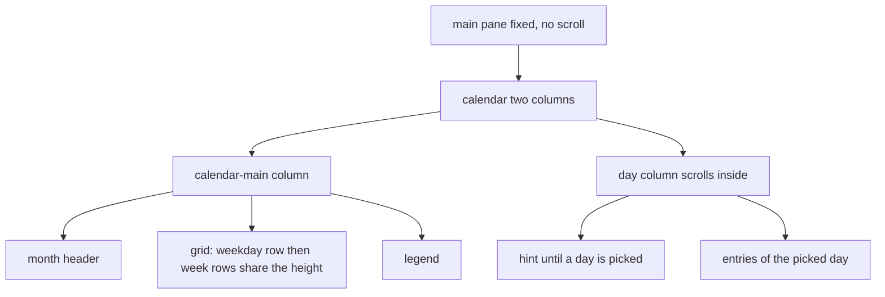

# window-polish — design diagrams

## Product flow

```
1. User launches the app --> a centred 1100x760 window opens with the macOS buttons at the left of our painted top bar
2. User drags the bar --> the window moves; pressing a nav link or button never starts a drag
3. User double-clicks the bar --> the window zooms like any macOS window
4. User shrinks the window --> it stops at 900x620; every view still fits
5. User opens Calendar --> the month fills the window height, no page scrolling
6. User clicks a day --> its entries appear in the column beside the month; a long list scrolls inside the column
```

Check:
- Is there any moment where the page itself would still scroll (calendar, journal, search, settings)?
- Do the macOS buttons ever overlap the wordmark at the minimum width?
- Does anything about this flow change on a non-macOS system (it should not break, only look native)?

## Components

Config and capability on one side, presentation on the other.



Check:
- Does anything in the production build depend on the dev-only harness?
- Is the capability applied to the main window only?
- Which component decides the minimum width, and is it the only one?

## Drag and zoom

What happens when the user presses on the bar.



Check:
- What does the user see if the permission were missing (nothing happens)?
- Does a press on the Settings button reach the window at all?

## Calendar layout

Regions of the calendar page inside the fixed pane.



Check:
- Do six week rows fit at 620 px height with the header and legend?
- Does the day column keep its width when no day is picked (no layout jump)?
- Is the column the only thing that can scroll?
